<picture>
  <source media="(prefers-color-scheme: dark)" srcset="./profile-dark.svg">
  <source media="(prefers-color-scheme: light)" srcset="./profile-light.svg">
  
</picture>

  
  
  

## 👋 About Me

I'm a third-year **Computer Engineering** student at **Sakarya University**.

During my internship at **GBB Bilişim**, I built the backend of **kARTVİN**, a public transportation app for the city of Artvin, as a RESTful API with **Laravel** and **PostgreSQL**. Now I'm taking that software engineering foundation into **AI**, with a focus on **generative AI** and **large language models**.

## 🚀 Featured Project

### [kARTVİN Backend](https://github.com/sekooo-ctrl/kartvin-backend) · Public Transportation API

`Laravel 13` `PHP 8.3` `PostgreSQL` `Sanctum` `PHPUnit`

- **30+ REST endpoints** consumed by a Flutter mobile app
- **Route planner** that finds direct and transfer connections and estimates travel time
- **Live bus tracking** simulation, **QR fare payment** and a **green-point reward** system
- Token-based auth and **18 feature test suites**

## 🛠️ Tech Stack

| | |
|---|---|
| **Backend** | PHP · Laravel · REST APIs · Laravel Sanctum |
| **Databases** | PostgreSQL · SQLite · SQL |
| **Languages** | PHP · Python · Java · C |
| **Tools** | Git · PHPUnit |
| **Learning** | Python · Machine Learning · LLMs |

## 🌱 Right Now

- 🐍 Learning **Python**, then moving on to **machine learning** and **LLMs**

## 📈 GitHub Stats

  <picture>
    <source media="(prefers-color-scheme: dark)" srcset="https://github-readme-stats.vercel.app/api?username=sekooo-ctrl&show_icons=true&include_all_commits=true&count_private=true&theme=github_dark&hide_border=true&bg_color=0d1117">
    
  </picture>
  <picture>
    <source media="(prefers-color-scheme: dark)" srcset="https://github-readme-stats.vercel.app/api/top-langs/?username=sekooo-ctrl&layout=compact&theme=github_dark&hide_border=true&bg_color=0d1117">
    
  </picture>

---

<b>🇹🇷 Türkçe</b>

 

Sakarya Üniversitesi Bilgisayar Mühendisliği 3. sınıf öğrencisiyim. GBB Bilişim'deki stajımda Artvin'in toplu taşıma uygulaması **kARTVİN**'in backend'ini **Laravel** ve **PostgreSQL** ile RESTful API olarak geliştirdim. Şimdi bu yazılım temelini **üretken yapay zekâ** ve **büyük dil modelleri** alanına taşıyorum.

